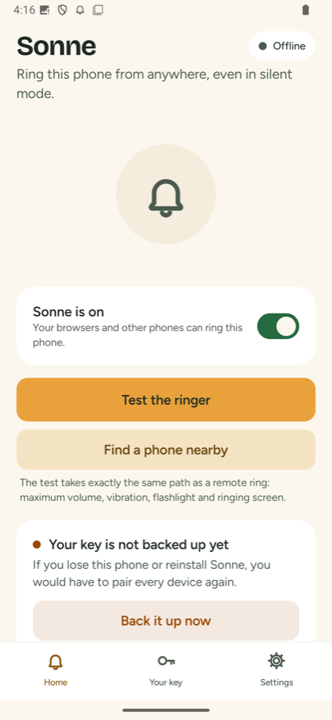
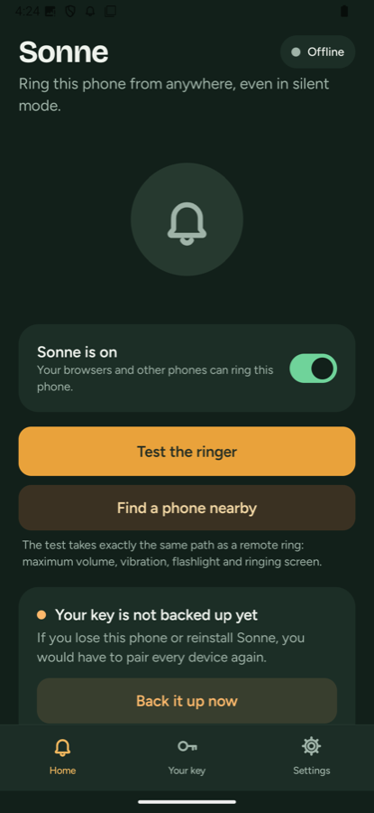
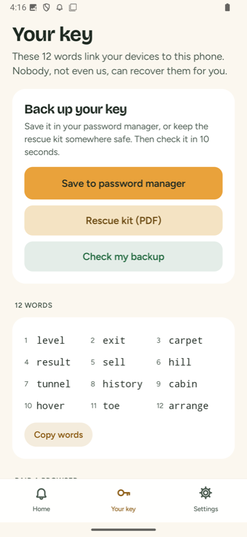
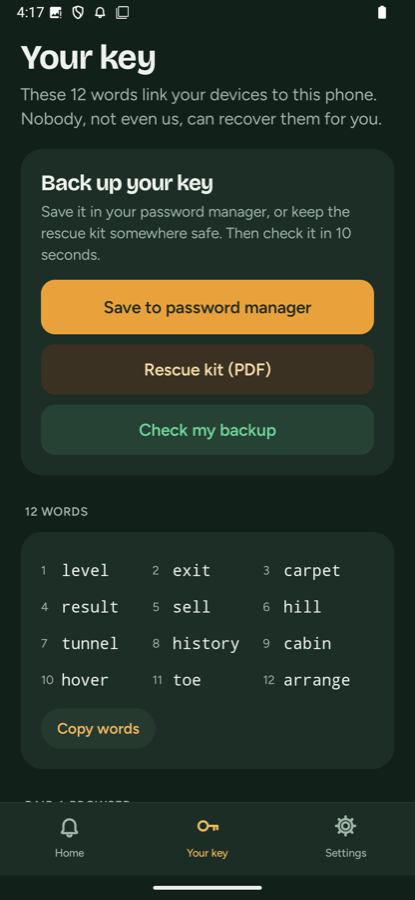
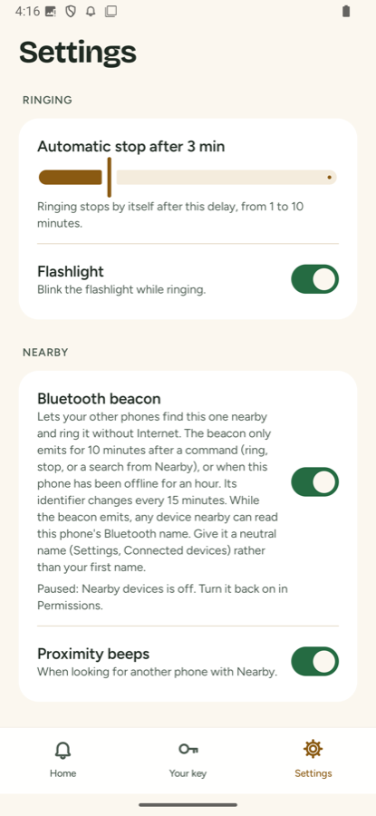
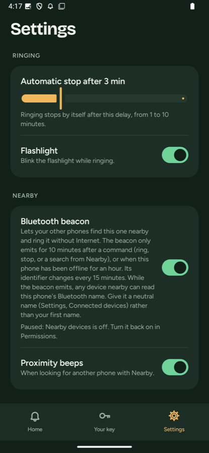
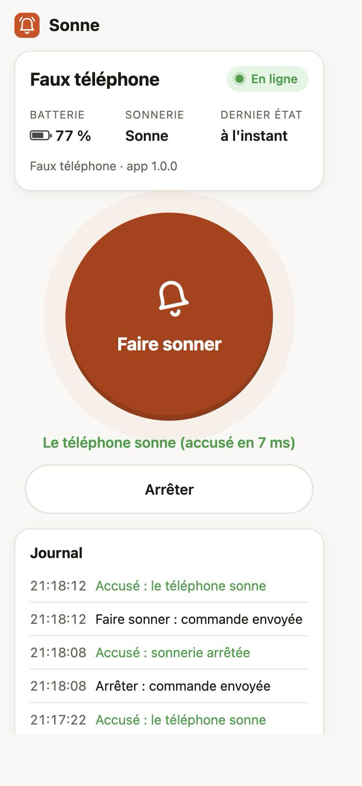

# Sonne

Ring your Android phone from a web page, even when it is on silent. No Google, no account.

The phone draws a secret on first launch and shares it with your browsers by QR code, link or 12 words. The relay only receives a derived identifier and fixed-size messages: commands and statuses are end-to-end encrypted, and the relay cannot tell a ring from a stop or a status check.

| Light | Dark |
| --- | --- |
|  |  |
|  |  |
|  |  |

Sonne has its own color, honey, the same in the icon, the app and the web page, in light and dark: flat, fully rounded, AA contrast checked. Titles in Bricolage Grotesque, text in Figtree. The app and the web page are in English.

## Install

- **Obtainium** (recommended, automatic updates): add the repository address, `https://github.com/sidalidev/sonne`. Obtainium picks the signed APK of the latest release.
- **APK by hand**: download `sonne-<version>.apk` from the [latest release](https://github.com/sidalidev/sonne/releases/latest), or from the relay (the exact address is in `https://sonne.sidali.dev/update/android.json`), and install it. Check it against `SECURITY.md` if you like.
- **Built-in update** (since 1.2.0): once a day and when it opens, the app asks the relay whether a new version exists (setting "Check for updates", on by default). If so: a "Update available" notification and a banner on the home screen. On tap, it downloads the APK, checks its SHA-256 and that its signing certificate is the one of the installed app, then opens Android's install screen, which always asks for your confirmation. The first time, Android asks you to allow Sonne to "install unknown apps".
- No Play Store: the app deliberately targets `targetSdk 34` so it can lift Do Not Disturb (see Limits).

## First steps

1. **Install the app** and open it. It explains what it does, then asks for a few settings (notifications, Do Not Disturb, unrestricted battery, full screen on the lock screen): each button opens the right system screen.
2. **Link a browser**: the app then opens the Your key screen. On the phone or computer that will act as the remote, scan the QR code with the camera, or paste the link into the page `https://sonne.sidali.dev`, or type the 12 words.
3. **Write down the 12 words** on paper or in your password manager: the day you look for your phone, they let you ring it from any browser, even at someone else's place.

Give it a try: "Test the ringer" in the app, then "Ring" in the page.

## Nearby

"It is not far, I walk toward it, and I ring it." Since 1.1, the Sonne app installed on **another phone** acts as a detector, even without Internet.

1. On the phone to protect, nothing to do: the **Bluetooth beacon** is on by default (Settings, "Bluetooth beacon"). Grant "Nearby devices" in the Permissions screen. It only broadcasts in **search mode**: for 10 min after each command (ring, stop, or the request sent by the Nearby screen), while ringing, or when the phone has been offline for an hour. The standby notification says "Bluetooth search on". Give the phone a neutral Bluetooth name (see Limits). On GrapheneOS, turn off the automatic Bluetooth timeout.
2. On the phone that searches: home, **Find a phone nearby**, then **My other phones**, **Add a phone**: scan the QR code from the Your key tab of the other phone, or paste its link, or type its 12 words. Check that the start of the identifier is the same on both sides.
3. The screen asks the phone, through the relay, to turn on its beacon (then every 8 min while it stays open) and says whether the request went through. Move around: the gauge goes from "Lost" to "Very hot", a beep speeds up as you get closer (can be turned off), the phone vibrates, and the screen shows how long ago the beacon was seen and the strength of the last signal.
4. **Ring**: if the phone was seen less than 10 s ago, the command goes straight over Bluetooth (no Internet, no relay) and the status comes back the same way (ringing or not, battery). Otherwise, or if Bluetooth fails, the same encrypted message goes through the relay: the phone never runs it twice.

Privacy: outside search mode, the phone broadcasts nothing. During search mode, the beacon only holds an 8-byte identifier derived from the secret and the time, which changes every 15 min. Without the secret, this identifier does not link two windows together; other signals can (see Limits). The searcher only keeps the derived keys of the other phones, scans without location permission (`neverForLocation`) and only while the Nearby screen is open. Details: "Bluetooth proximity" section of [`docs/PROTOCOL.md`](docs/PROTOCOL.md).

## Limits

- **Do Not Disturb**: the app lifts it while ringing and restores it on stop, including "Total silence", thanks to `targetSdk 34` (checked on Android 16). A version targeting `targetSdk 35` or later would lose this power: the ring would stay silent in "Total silence".
- **Battery optimization**: without the exemption, Android may cut the connection to the relay during deep sleep.
- **Full screen**: the ringing screen above the lock screen depends on the "full screen notifications" permission (Android 14 and later). Without it, an alarm notification with a Stop button still shows.
- **In-memory relay**: the relay writes nothing to disk. If it restarts, it forgets pending commands and when phones were last seen ("Never seen by the relay" until the phone reconnects, a few seconds to a few minutes).
- **Pending command**: if the phone is offline, the command waits on the relay for 15 min at most. Beyond that, the phone would refuse it anyway (freshness window).
- **Safari** (iPhone, Mac) may forget a site after 7 days without a visit, and the paired phone with it: add the page to the home screen, or keep your 12 words.
- **Browser history**: a pairing link opened directly stays in the history, and in its sync (Chrome, Firefox). On a synced browser, paste the link or type the 12 words in the page's form instead.
- **Nearby**: signal strength depends on walls, pockets and phone models. The gauge guides you closer, it does not measure a distance, and its thresholds are still estimates. During search mode: anyone in range can connect to the phone and read its **Bluetooth name** (give it a neutral name, not your first name); devices already paired (car, watch) may recognize the beacon; anyone with the 12 words, the QR code or the link can know when the phone is nearby and open search mode ("Change key" removes that power); the beacon identifier can be replayed by a malicious transmitter (the app flags it); a stranger can disturb the Bluetooth path, the relay remains the fallback. If the lost phone has no Internet, its beacon only turns on after an hour offline. On GrapheneOS, the automatic Bluetooth timeout turns the beacon off.
- **Trust in the relay**: it only receives an identifier, but it serves the page that handles your secret. Only use a relay you trust.

## Repository contents

- `android/`: the Android app, see [`android/README.md`](android/README.md)
- `relay/`: the WebSocket relay (Node 22, a single dependency: `ws`)
- `web/`: the control page served by the relay (no framework, installable as a PWA)
- `deploy/docker-compose.yml`: deployment of the relay behind Traefik
- `docs/PROTOCOL.md`: protocol and architecture
- `docs/VECTEURS.json`: test vectors shared by the relay, the web page and the app
- `PRIVACY.md`: what leaves the device, where to, encrypted or not (the same text is in the app)
- `SECURITY.md`: report a vulnerability, fingerprint of the signing certificate; `docs/THREAT_MODEL.md`; dated internal reviews in `docs/security/`
- `docs/permissions.txt`: expected permissions; `tools/check-permissions.sh` and `tools/check-repo.sh`, run by CI (`.github/workflows/ci.yml`) and by `tools/release-android.sh`

## Web page

Open the relay address (for example `https://sonne.sidali.dev`) in any browser, computer or phone.

- **Add a phone**: scan the QR code shown by the app (it opens the pairing link, the page asks for confirmation with the start of the identifier), or paste the link, or type the 12 words. The secret is read from the `#s=…` fragment, removed from the address bar and never sent to the relay. The page only keeps non-exportable WebCrypto keys in IndexedDB: a script reading the storage could not take the secret away.
- **Ring** sends an encrypted `ring` command (172 bytes, like every command); the page shows the phone's acknowledgment ("Phone is ringing") or, if it is offline, that the command is waiting on the relay (a few minutes, 15 at most).
- **Encrypted commands**: the page sends them to a phone as soon as it has received a status from it announcing them (app 1.6 and later), and remembers it. An app on 1.5 or older still gets the old signed format until it updates; the activity log notes "Commands to this phone are now encrypted" when it switches.
- If the phone has never been seen, or not for more than a day, the page reminds you that changing the key or the server in the app means adding it again.
- On iPhone and Mac, Safari may forget this phone after 7 days without a visit: add the page to the home screen, or keep your 12 words. The page asks the browser for persistent storage.
- **Stop** sends `stop`. The badge shows "Online" or "Offline, seen … ago", with the battery and the ringing state.
- Several phones are possible (local name, rename, delete in "My phones"). The log keeps the last 20 events per phone.
- The page is installable (manifest and service worker) and loads nothing from outside: no CDN, no remote font, no analytics.

The page's cryptography (`web/crypto.js`, WebCrypto: HKDF, HMAC-SHA256, AES-GCM) is an ES module without DOM, checked in Node against `docs/VECTEURS.json` and cross-checked with `relay/crypto.js`.

### Try it without the Android app

```bash
cd relay
npm install
PORT=7700 npm start                                   # terminal 1: the relay
node tools/faux-telephone.js --relais http://localhost:7700   # terminal 2: a fake phone
```

The fake phone prints its pairing link (`http://localhost:7700/#s=…`): open it in the browser, click "Ring", it writes `SONNE` in its console and sends back an encrypted status as acknowledgment. It behaves like app 1.6 (encrypted commands); `--ancien` mimics app 1.5 (old signed format only), `--coupure` app 1.8 (old format cut off).



## Relay

The relay (`relay/server.js`, Node 22, single dependency `ws`) passes opaque messages between the phone and the browsers. It only knows the id (derived from the secret) and, for the phone, the proof P the id is derived from. It can neither read nor check commands, nor read statuses, and writes nothing to disk. Full protocol: [`docs/PROTOCOL.md`](docs/PROTOCOL.md) (v2, encrypted commands v3).

The id never goes into a URL (proxy access logs would record it): it travels in a header.

| Route | Header | Role |
| --- | --- | --- |
| `GET /` | | the web page (files from `web/`) |
| `GET /ws/phone` | `Sec-WebSocket-Protocol: sonne.v2, sonne.p.<P>` | WebSocket of the phone, which proves it holds the secret; receives `welcome` then the commands |
| `GET /ws/ctrl` | `Sec-WebSocket-Protocol: sonne.v2, sonne.id.<id>` | WebSocket of the browsers: they send `cmd`, receive `presence` and `state` |
| `POST /api/cmd` | `X-Sonne-Id: <id>` | encrypted command in JSON (v3, 172 bytes), for scripts and shortcuts: `{"delivered":true}`, or `{"delivered":false,"queued":true}` for any v3 command (the relay does not see its type). Old signed format (v2) during the transition only: `queued:true` for ring and stop, `queued:false` for ping; after the cut-off, 400 |
| `GET /api/presence` | `X-Sonne-Id: <id>` | `{ "online": bool, "lastSeen": ms }` |
| `GET /health` | | `{ ok, phones, ctrls, uptime, version }` |
| `GET /update/android.json` | | announcement of the latest app version (built-in update), 5 min cache; 404 without `SONNE_RELEASES_DIR` |
| `GET /download/<name>.apk` | | published APKs, from `SONNE_RELEASES_DIR` (name strictly validated) |

Behavior: WebSocket ping every 25 s for browsers (cut after 60 s of silence), every 4 min for the phone (cut after 10 min), to spare its battery; application heartbeat `hb` on the phone's request; if the phone is offline, the last 10 encrypted commands (and, during the transition, the last 5 signed `ring` and `stop`) are kept for 15 min at most, and a command delivered to a connection that dies before the acknowledgment is delivered again; 20 commands per minute per id, 60 requests per minute per IP (an IPv6 counts as its /64); 20 open connections per IP, 10,000 in total, 16 browsers per phone; 4 KB per message; a single phone per id (the most recent replaces the old one, only if it presents the right proof). The log only holds counters (including `cmdV2` and `cmdV3`, the number of commands per format, never their type) and errors, never a full id. Clean shutdown on `SIGTERM`.

The relay answers the browser that sends a command with `{"type":"relayed","nonce","delivered","queued"}` (or `{"type":"error","nonce","status","error"}` when refused). This message never goes to the phone.

### Variables

| Variable | Default | Role |
| --- | --- | --- |
| `PORT` | `7700` | listening port |
| `SONNE_QUEUE_MIN` | `15` | queue duration, in minutes: **15 at most**, beyond that the phone refuses the command (15 min freshness window) |
| `SONNE_PHONE_PING_S` | `240` | phone ping interval, in seconds |
| `SONNE_PHONE_DEAD_S` | `600` | silence after which the phone connection is cut, in seconds |
| `SONNE_TRUST_PROXY` | `0` | `1` behind a proxy (Traefik, nginx): the per-IP limit reads the last entry of `X-Forwarded-For` |
| `SONNE_WEB_DIR` | `../web` | web page folder |
| `SONNE_CMD_V2` | `1` | `1` during the transition to encrypted commands: the old signed format (app 1.5 and older) is still relayed. `0` after the cut-off (default of relay 1.7): it is refused with 400 (`docs/PROTOCOL.md`, "Transition, then cut-off of the old format") |
| `SONNE_RELEASES_DIR` | none | folder (read only) of `android.json` and the APKs served by `/update` and `/download`; in `deploy/docker-compose.yml`, the host folder `SONNE_RELEASES_HOST_DIR` mounted on `/releases` |

### Self-hosting with Docker

The image is built from the repository root (the relay also serves `web/`):

```bash
docker build -f relay/Dockerfile -t sonne-relay .
docker run -d --name sonne-relay --restart unless-stopped -p 7700:7700 sonne-relay
```

Then put an HTTPS proxy in front (WebSocket required): the page needs a secure context for WebCrypto, except on `localhost`. In the Android app, set the relay address to yours; pairing links will use this address, and browsers already paired will have to be linked again from this relay's page.

The proxy must not cut a WebSocket connection idle for 4 min (phone ping). Traefik v2 has no timeout by default; with Traefik v3, check `respondingTimeouts.readTimeout` on the entrypoint (60 s by default), or lower `SONNE_PHONE_PING_S`. Access logs can stay on: they do not record headers by default, and the id is no longer in the URL.

With Traefik (external network `traefik_web`, resolver `letsencrypt`), `deploy/docker-compose.yml` is ready: replace `sonne.sidali.dev` with your domain, set the host folder of published versions, then

```bash
cd deploy
SONNE_RELEASES_HOST_DIR=/srv/sonne/releases docker compose up -d --build
```

`SONNE_RELEASES_HOST_DIR` can also go into a `.env` file next to the compose file. The container runs as user `node`, with a read-only file system and a healthcheck on `/health`.

### Publish a version of the app

```bash
export SONNE_VPS=user@your-server            # SSH target that hosts the relay
export SONNE_RELEASES_DIR=/srv/sonne/releases # folder on that server, mounted on /releases in the relay
tools/release-android.sh --notes "Short release notes in English"
```

The script runs the JVM tests, builds the signed release APK (`~/.sonne`), computes its SHA-256 and the fingerprint of its certificate (`apksigner verify --print-certs`), writes `android.json`, copies the APK then the announcement to the server, checks `https://sonne.sidali.dev/update/android.json` (`SONNE_BASE_URL` for another relay) and the download, then creates the GitHub release with the APK, its checksum and the `CHANGELOG.md` section as notes. `--notes` is the short text shown by the app. `--sans-publication` only builds and prepares (`android/app/build/release/`), without the two variables.

A self-hosted relay without `SONNE_RELEASES_DIR` answers 404: phones set to it see no update. It can publish the same files (a copy of `android.json` and of the APK): the app refuses any APK whose signature is not the one of the installed app anyway.

## Relay tests

```bash
cd relay
npm install
npm test
```

The tests cover the cryptography of the relay and the web page (shared vectors, proof P) and the relay itself (delivery, acknowledgments, presence, queue and in-flight commands, fake phone without the proof, rate and connection limits, IPv6, invalid ids, message size, ping per role, heartbeat, clean shutdown).

To regenerate the vectors: `npm run vecteurs`.

## License

Apache-2.0, see `LICENSE`.

## Credits

- Fonts **Bricolage Grotesque** (The Bricolage Grotesque Project Authors) and **Figtree** (The Figtree Project Authors), under the SIL Open Font License 1.1, taken from the `github.com/google/fonts` repository (`ofl/bricolagegrotesque`, `ofl/figtree`). Licenses: `android/fonts/` and `web/fonts/`. Bricolage Grotesque is embedded as a static instance (weight 700, optical size 36); in the web page, subset to Latin characters. Figtree is embedded as is (variable font).
- Icon and drawings: made for Sonne, same license as the code.
